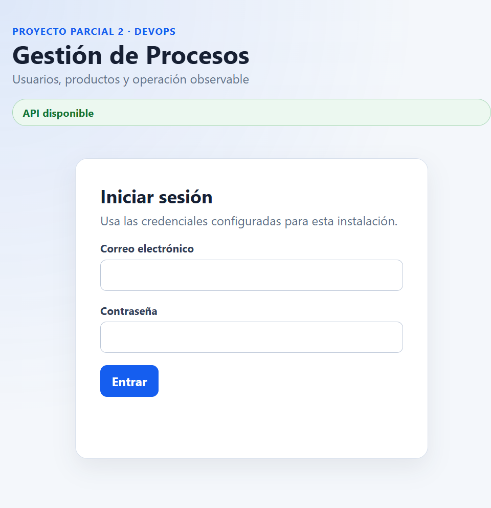
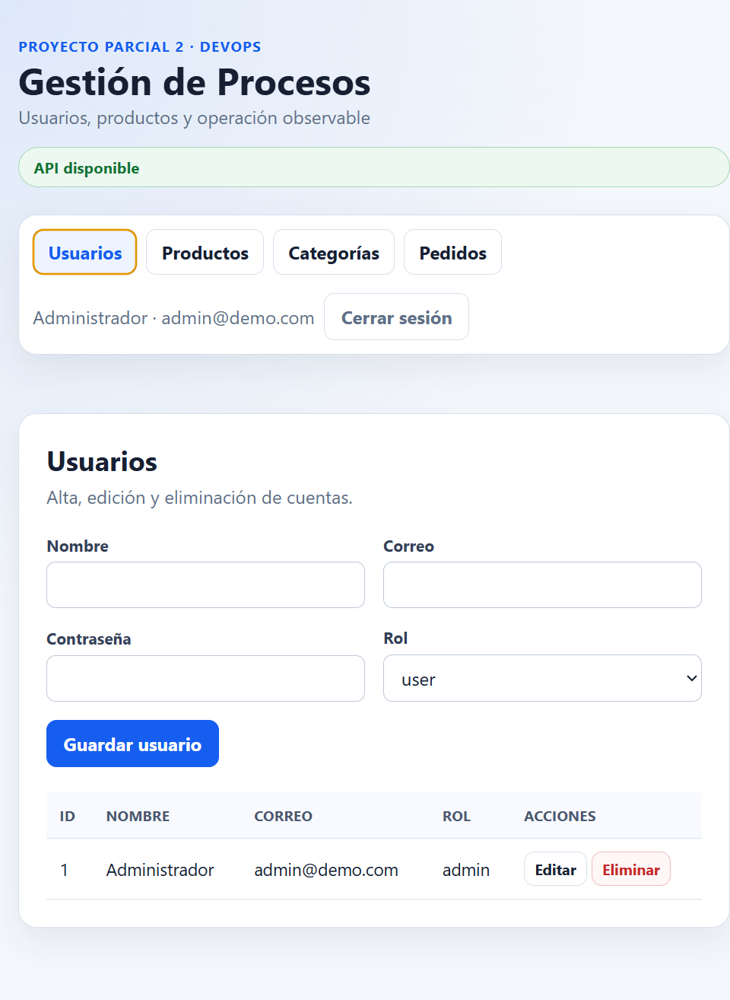
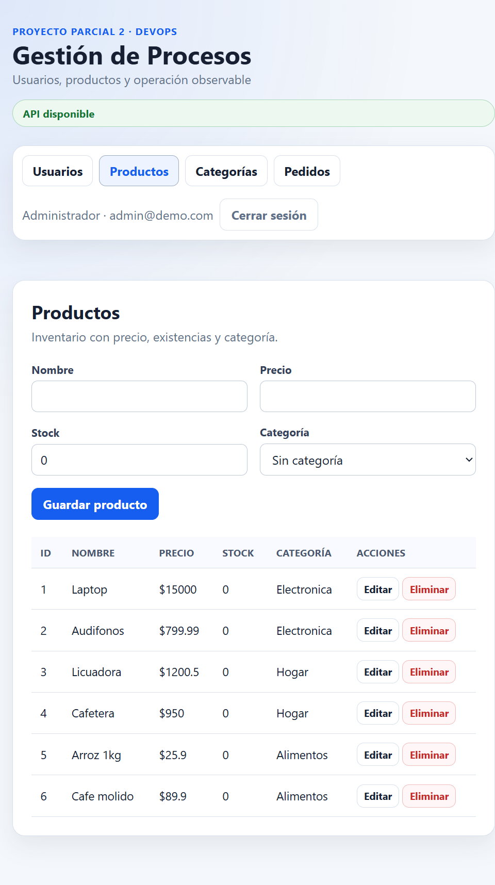

# Gestión de Procesos — CI/CD, pruebas automatizadas y observabilidad

Sistema web con autenticación JWT, gestión de usuarios y productos, y una canalización CI/CD que solo despliega en AWS EC2 después de aprobar Jest y Playwright. La aplicación instrumentada con OpenTelemetry envía logs, métricas y trazas a OpenObserve mediante un OpenTelemetry Collector.

**Autor:** Sergio Abdiel Gonzalez Bravo
**Grupo:** IDGS15
**Materia:** Gestión DevOps — Proyecto parcial 2
**Repositorio:** https://github.com/Chekito2720/DEVOPS

## Funcionalidades

- Login con JWT y expiración configurable.
- CRUD de usuarios, restringido a administradores.
- CRUD de productos con precio, stock y categoría opcional.
- Conservación de categorías, pedidos, respaldos de SQLite y protocolo TCP 6061.
- Frontend sin framework, servido por Express.
- Pruebas de integración con Jest y Supertest; cobertura mínima global de 70 %.
- Pruebas E2E de UI y API con Playwright y Chromium.
- Logs estructurados, métricas HTTP y trazas con spans de base de datos.
- Métricas de CPU, RAM, disco, red y carga de la EC2 mediante `host_metrics`.
- Pipeline GitHub Actions con cinco jobs y despliegue condicionado a pruebas.
- Stream `ci_pipeline` en OpenObserve para registrar cada etapa del pipeline.

## Evidencia visual local

Estas capturas corresponden a la aplicación ejecutada localmente, antes del despliegue en EC2:

| Figura 1 — Inicio de sesión | Figura 2 — Administración de usuarios |
|---|---|
|  |  |



*Figura 3 — Gestión de productos.*

Los productos de esta captura provienen de la base legacy migrada. La migración agrega la columna `stock` sin modificar productos existentes, por lo que su valor inicial es `0`; el `seed.sql` de una base nueva inicializa existencias de ejemplo.

## Arquitectura

```text
Desarrollador
     │ git push a main
     ▼
┌──────────────────────────────── GitHub Actions ───────────────────────────────┐
│ test (Jest ≥ 70 %) ─┐                                                     │
│                     ├─► build-and-push (Docker Hub) ─► deploy (SSH EC2)   │
│ e2e (Playwright) ───┘                                                     │
│ report (always) ─────────────────────────────────────────────┐            │
└──────────────────────────────────────────────────────────────┼────────────┘
                                                               ▼
                                                        OpenObserve
                                                               ▲
                         OTLP/HTTP: logs, metrics, traces       │
                                                               │
┌──────────────────────── AWS EC2 (Ubuntu + Docker) ───────────┴────────────┐
│                                                                          │
│  ┌──────────┐   OTLP    ┌────────────────┐   OTLP/HTTP   ┌──────────────┐  │
│  │ api-cicd │──────────►│ otel-collector │──────────────►│ openobserve  │  │
│  │ :80      │           │ host network   │               │ :5080        │  │
│  └────┬─────┘           │ + hostmetrics  │               └──────────────┘  │
│       │ SQLite          └────────────────┘                                  │
│       ▼                                                                   │
│  volumen api_data                                                         │
└──────────────────────────────────────────────────────────────────────────┘
```

El Collector usa red `host` para que las métricas de red correspondan a la interfaz real de la EC2. El puerto OTLP `4318` no necesita exponerse en Internet: la API lo alcanza mediante `host.docker.internal`.

## Estructura

```text
.github/workflows/main.yml       Pipeline de cinco jobs
public/                          Frontend HTML, CSS y JavaScript
docs/figures/                    Capturas locales de la interfaz
e2e/sistema.spec.ts              Pruebas E2E de UI y API
tests/api.test.js                Pruebas Jest + Supertest
app.js                           Rutas REST, validaciones y esquema de respuesta
auth.js                          Firma/verificación JWT y autorización por rol
db.js                            SQLite, seed, migración y respaldos
responses.js                     Envelope común de las respuestas REST
server.js                        Servidor HTTP y servidor TCP legacy
telemetry.js                     Logs, métricas y spans SQL
tracing.js                       Inicialización del SDK OpenTelemetry
seed.sql                         Datos iniciales reproducibles
Dockerfile                       Imagen node:22-slim multi-stage y non-root
docker-compose.yml               API, OpenObserve y Collector
otel-collector-config.yaml       Receivers, processors, exporters y pipelines
playwright.config.ts             Configuración E2E
```

## Contrato de respuestas REST

Todas las respuestas JSON de la API, incluidos los errores, usan el mismo envelope:

```json
{
  "statusCode": 200,
  "responseTime": 1.43,
  "request": "GET",
  "path": "/api/health",
  "timestamp": "2026-11-22T04:56:17.083Z",
  "data": {
    "status": "ok",
    "version": "unknown",
    "autor": "Sergio Abdiel Gonzalez Bravo",
    "fecha": "2026-11-22T04:56:17.083Z"
  }
}
```

- `statusCode`: código HTTP.
- `responseTime`: latencia de la respuesta en milisegundos.
- `request`: método HTTP (`GET`, `POST`, `PUT`, `DELETE`).
- `path`: ruta sin query string.
- `timestamp`: fecha y hora ISO 8601 en UTC.
- `data`: contenido de una respuesta exitosa.
- `error`: mensaje de una respuesta fallida; nunca coexiste con `data`.

Las respuestas del protocolo TCP 6061 conservan su contrato anterior `{statusCode, data|error}`. El servidor TCP reconstruye comandos fragmentados y procesa varias líneas recibidas en una misma lectura; una respuesta siempre termina con salto de línea.

## Endpoints

| Método | Ruta | Acceso | Descripción |
|---|---|---|---|
| GET | `/api/health` | Público | Estado de la API |
| POST | `/api/auth/login` | Público | Devuelve token JWT y usuario |
| GET | `/api/users` | Admin | Lista usuarios |
| GET | `/api/users/:id` | Admin | Detalle de usuario |
| POST | `/api/users` | Admin | Crea usuario |
| PUT | `/api/users/:id` | Admin | Actualiza usuario |
| DELETE | `/api/users/:id` | Admin | Elimina usuario; no permite autoeliminarse |
| GET | `/api/productos` | Autenticado | Lista productos |
| GET | `/api/productos/:id` | Autenticado | Detalle de producto |
| POST | `/api/productos` | Autenticado | Crea producto |
| PUT | `/api/productos/:id` | Autenticado | Actualiza producto |
| DELETE | `/api/productos/:id` | Autenticado | Elimina producto |
| GET | `/api/categorias` | Autenticado | Lista categorías legacy |
| POST | `/api/categorias` | Autenticado | Crea categoría legacy |
| DELETE | `/api/categorias/:id` | Autenticado | Elimina categoría sin productos asociados |
| GET | `/api/pedidos` | Autenticado | Lista pedidos legacy |
| POST | `/api/pedidos` | Autenticado | Crea pedido legacy |
| GET | `/api/db/backup` | Admin | Genera un respaldo SQLite |
| DELETE | `/api/db/clear` | Admin | Vacía categorías, productos y pedidos |

El token se envía como `Authorization: Bearer <token>`.

## Requisitos

- Node.js `22.15` o superior.
- npm 10 o superior.
- Docker Desktop para las pruebas de contenedor.
- Chromium instalado por Playwright para las pruebas E2E.

## Ejecución local

```bash
# Instalar dependencias
npm ci

# Iniciar API + frontend (HTTP 80 y TCP 6061)
npm start

# Alternativa con telemetría; requiere un Collector en localhost:4318
npm run start:instrumented
```

En Windows, para evitar usar el puerto 80:

```powershell
$env:PORT="3000"
npm start
```

La base de desarrollo queda en `data/app.db`. En las pruebas, `NODE_ENV=test` usa SQLite en memoria y nunca modifica la base real.

Credenciales de desarrollo:

```text
Usuario: admin@demo.com
Password: Admin123!
```

> `JWT_SECRET` y `ADMIN_PASSWORD` son obligatorios en `NODE_ENV=production`; la aplicación no arranca con secretos de desarrollo en producción.

## Pruebas

```bash
# Jest + Supertest, cobertura y umbral global de 70 %
npm test

# Playwright: UI + API en Chromium
npx playwright install chromium
npm run e2e

# Abrir el reporte HTML generado
npx playwright show-report
```

La suite actual cubre autenticación, autorización, usuarios, productos, categorías, pedidos, errores de validación, esquema de respuesta, migración de una base legacy, contrato TCP 6061 y contratos de UI/API.

## Docker

```bash
# Construir la imagen ligera
docker build -t webapp:parcial2 .

# Ejecutar con secretos de producción
docker run --rm -p 8080:80 \
  -e JWT_SECRET="un-secreto-de-al-menos-32-caracteres" \
  -e ADMIN_PASSWORD="Admin123!" \
  webapp:parcial2
```

La imagen final usa `node:22-slim`, compila las dependencias nativas en una etapa separada, elimina dependencias de desarrollo y ejecuta la aplicación con el usuario no root `node`. `better-sqlite3` hace que `slim` sea más seguro que Alpine para este proyecto.

## Despliegue en EC2

### 1. Preparar la instancia

1. Instalar Docker Engine y Docker Compose v2.
2. Crear `~/app`.
3. Configurar un swap de 2 GB si la instancia tiene 1 GB de RAM.
4. Abrir en el Security Group: TCP 22 (SSH), 80 (HTTP), 6061 (TCP legacy) y 5080 (OpenObserve).
5. Crear `~/app/.env` con permisos `600` a partir de `.env.example`.

Variables del servidor:

```dotenv
DOCKERHUB_USERNAME=tu_usuario_dockerhub
IMAGE_TAG=latest
APP_VERSION=unknown
OO_USER=admin@ejemplo.com
OO_PASS=TuPasswordFuerte123
OO_INGEST_TOKEN=o2oi_token_default_de_openobserve
OO_AUTH_B64=base64_sin_salto_de_linea_de_OO_USER_COLON_OO_INGEST_TOKEN
JWT_SECRET=secreto_aleatorio_de_64_caracteres
JWT_EXPIRES_IN=2h
ADMIN_EMAIL=admin@demo.com
ADMIN_PASSWORD=TuPasswordAdmin123!
```

Generación segura del secreto JWT:

```bash
openssl rand -hex 32
```

En `.env`, sustituye todos los valores de ejemplo. Evita `$`, `#`, espacios y comillas sin escapar en contraseñas porque Docker Compose realiza interpolación de variables.

`OO_USER` y `OO_PASS` autentican al administrador root de OpenObserve. `OO_INGEST_TOKEN` es un token de organización generado por OpenObserve y es el único secreto que debe usar el Collector para enviar OTLP. `ADMIN_PASSWORD` se aplica al crear el administrador por primera vez; cambiarlo después en `.env` no modifica una base ya inicializada. El administrador bootstrap no se vuelve a crear si se elimina deliberadamente; si la base queda sin ningún rol `admin`, la aplicación se niega a iniciar para evitar una instalación inutilizable o insecuramente administrada.

### 2. Levantar la pila

La primera vez se debe iniciar OpenObserve para obtener su token de ingesta, calcular `OO_AUTH_B64` y después levantar la pila completa:

```bash
cd ~/app
cp /ruta/al/repositorio/docker-compose.yml .
cp /ruta/al/repositorio/otel-collector-config.yaml .
cp /ruta/al/repositorio/.env.example .env
chmod 600 .env

# Editar .env con Docker Hub, credenciales root, JWT y credenciales de la app.
docker compose pull
docker compose up -d openobserve

set -a
source .env
set +a

# Esperar a que OpenObserve responda y leer el token de ingesta por defecto.
until curl -fsS -u "$OO_USER:$OO_PASS" \
  http://localhost:5080/api/default/ingestion-tokens > /tmp/oo-tokens.json; do
  sleep 2
done
TOKEN=$(jq -r '.data[] | select(.name == "default" and .enabled == true) | .token' \
  /tmp/oo-tokens.json | head -n 1)
test -n "$TOKEN" && test "$TOKEN" != "null"

sed -i "s|^OO_INGEST_TOKEN=.*|OO_INGEST_TOKEN=$TOKEN|" .env
AUTH=$(printf %s "$OO_USER:$TOKEN" | base64 | tr -d '\n')
sed -i "s|^OO_AUTH_B64=.*|OO_AUTH_B64=$AUTH|" .env
unset TOKEN AUTH OO_PASS

# Levantar API, OpenObserve y Collector.
docker compose up -d
docker compose ps
curl -fsS http://localhost/api/health
# Verificación TCP opcional si `nc` está instalado:
# printf '{get:{"id":1}}\n' | nc localhost 6061
```

El token también puede verse en **OpenObserve → IAM → Ingestion Tokens**. La configuración validada en OpenObserve v1.1.2 usa el token `o2oi_...` para la ingesta OTLP; por eso `OO_AUTH_B64` codifica `OO_USER:OO_INGEST_TOKEN`, no la contraseña root.

El volumen `api_data` conserva SQLite entre despliegues. Antes del primer despliegue desde un contenedor legacy, se debe copiar la base existente al volumen o conservar el respaldo generado por la migración.

### 3. Secrets de GitHub

En **Settings → Secrets and variables → Actions** crear:

| Secret | Valor |
|---|---|
| `DOCKERHUB_USERNAME` | Usuario de Docker Hub |
| `DOCKERHUB_TOKEN` | PAT de Docker Hub, nunca la contraseña de la cuenta |
| `EC2_HOST` | IP pública de la EC2 |
| `EC2_SSH_KEY` | Contenido completo del `.pem`, incluyendo `BEGIN` y `END` |
| `OPENOBSERVE_URL` | `http://<IP_EC2>:5080` |
| `OPENOBSERVE_USER` | `default` (nombre del token de ingesta) |
| `OPENOBSERVE_PASSWORD` | Mismo valor que `OO_INGEST_TOKEN` |

El pipeline envía sus eventos al stream `ci_pipeline` usando el token de ingesta, por lo que la contraseña root de OpenObserve no sale de la EC2. No escribir IPs, contraseñas, tokens o llaves en el repositorio.

## Pipeline CI/CD

`.github/workflows/main.yml` contiene cinco jobs:

1. **test**: Jest y cobertura; falla si alguna métrica global baja de 70 %.
2. **e2e**: Playwright para UI y API; ejecuta en paralelo con `test`.
3. **build-and-push**: solo si `test` y `e2e` terminan en `success`; publica `latest` y el hash del commit.
4. **deploy**: solo después de una imagen publicada; copia la configuración por SCP, actualiza Compose y espera un healthcheck exitoso.
5. **report**: se ejecuta con `always()` y envía a OpenObserve los resultados de las cuatro etapas, commit, rama, actor, `run_id`, trigger y timestamp.

La condición explícita de `build-and-push` y `deploy` garantiza que una prueba fallida impida abrir la conexión SSH. El job `report` conserva la evidencia del fallo y de los jobs omitidos.

## Observabilidad

### Señales de la aplicación

- Logs: `request`, `login exitoso`, `login fallido` y excepciones.
- Métricas: `http_requests_total` e `http_request_duration_ms`, con `route`, `method` y `status_code`.
- Trazas: span HTTP/Express y spans `db.*` para operaciones SQLite.

### Señales de infraestructura

El receiver `host_metrics` collecta `system.cpu.utilization`, `system.memory.utilization`, métricas de disco/filesystem, red y carga.

### Consultas iniciales para el dashboard

```promql
1 - avg(system_cpu_utilization{state="idle"})
system_memory_utilization{state="used"}
sum by (route) (rate(http_requests_total[1m]))
sum by (status_code) (rate(http_requests_total{status_code=~"4..|5.."}[1m]))
histogram_quantile(0.95, sum by (le, route) (rate(http_request_duration_ms_bucket[1m])))
```

Los nombres y campos exactos se deben confirmar en la interfaz de OpenObserve después de la primera ingesta.

### Temperatura

Una EC2 es una máquina virtual y normalmente no expone sensores térmicos reales al sistema operativo. El Collector no puede generar una temperatura de hardware válida. Se debe documentar la limitación y no fabricar una gráfica. En la EC2 puede verificarse con:

```bash
ls /sys/class/thermal
```

## Demostración de aceptación

### Commit fallido

1. Introducir un error visual o de endpoint.
2. Confirmar que Playwright falla.
3. Verificar que `build-and-push` y `deploy` aparecen como `skipped`.
4. Confirmar en `ci_pipeline`: `e2e_tests=failure`, `build_push=skipped`, `deploy=skipped`.
5. Confirmar que la aplicación en producción no cambió.

### Commit válido

1. Revertir el error.
2. Confirmar que Jest y Playwright pasan.
3. Verificar `build-and-push=success` y `deploy=success` en OpenObserve.
4. Confirmar que la nueva versión está disponible en la URL pública.

## Seguridad

- `.env`, `.pem`, tokens y contraseñas no se versionan.
- JWT y contraseña administrativa son obligatorios en producción.
- Cada petición autenticada revalida el usuario y su rol actual; cambiar el rol o la contraseña incrementa `token_version` e invalida los tokens emitidos anteriormente, y eliminar el usuario invalida sus tokens.
- Las operaciones de usuarios y administración de base de datos exigen rol `admin`.
- La API corre como usuario no root en la imagen Docker.
- El acceso a OpenObserve por HTTP es aceptable únicamente para el alcance académico; en producción debe usarse HTTPS y una cuenta de ingestión separada.
- Rotar las credenciales después de la revisión.
